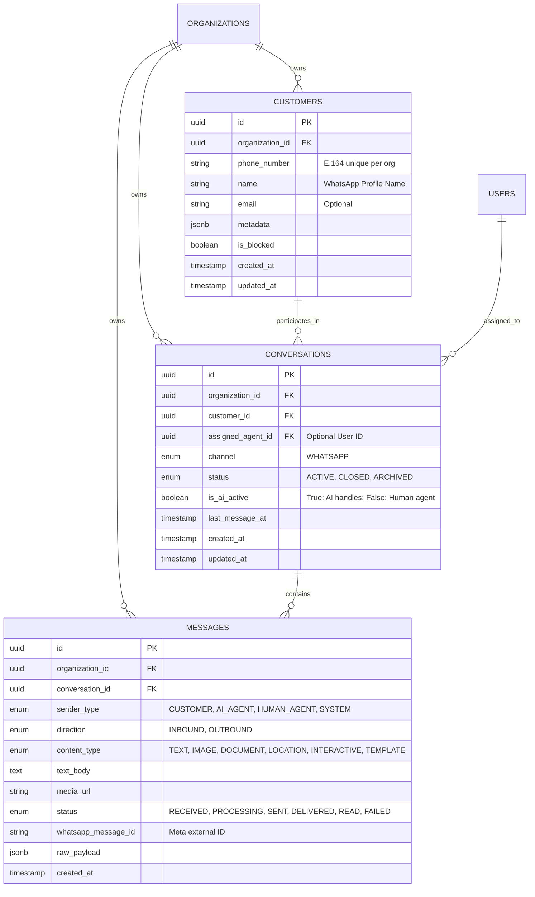
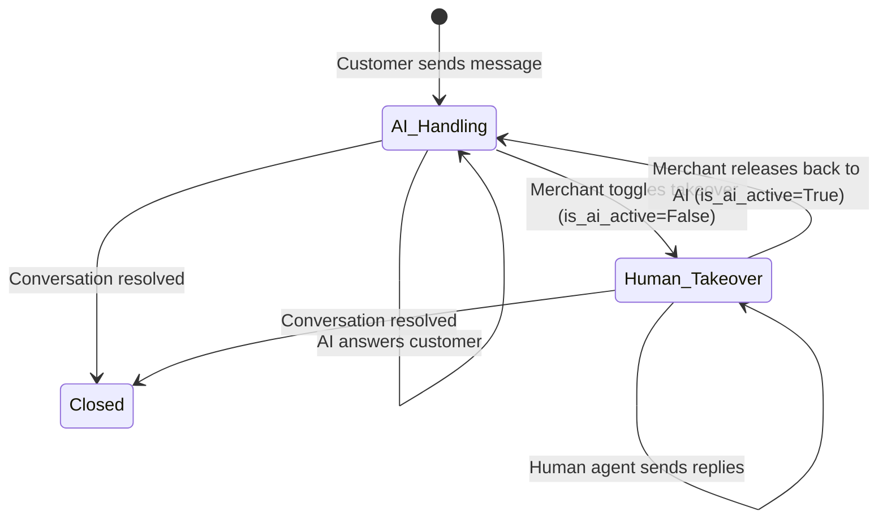

# Implementation Plan: 004-conversations

## 1. Architecture & Entity Relationship

---

## 2. Human Takeover State Machine

---

## 3. Implementation Phases

1. **Phase 1: Domain Models & Database Central Registry**:
   - Define `Customer` in `app/modules/customers/models.py`.
   - Define `Conversation` and `Message` in `app/modules/conversations/models.py`.
   - Re-export all models in `app/db/models.py`.
2. **Phase 2: Database Migration**:
   - Generate Alembic revision `003_conversations_and_customers.py`.
   - Add unit tests verifying schema creation, foreign key constraints, and downgrade cleanup.
3. **Phase 3: Validation Schemas**:
   - Define Pydantic v2 schemas for customers, conversations, messages, and human takeover requests.
4. **Phase 4: Business Services**:
   - `CustomerService`: Phone number normalization, customer upsert.
   - `ConversationService`: Get-or-create active conversation, list conversations, takeover toggle.
   - `MessageService`: Message creation, deduplication by `whatsapp_message_id`, pagination.
5. **Phase 5: REST API Endpoints**:
   - Customers router under `/api/v1/customers`.
   - Conversations router under `/api/v1/conversations`.
   - Mount under master `api_v1_router`.
6. **Phase 6: Multi-Tenant Isolation & Integration Verification**:
   - Verify that Merchant A cannot access, read, or send messages into Merchant B's conversations.
   - Verify phone number reuse across different merchants without conflict.

