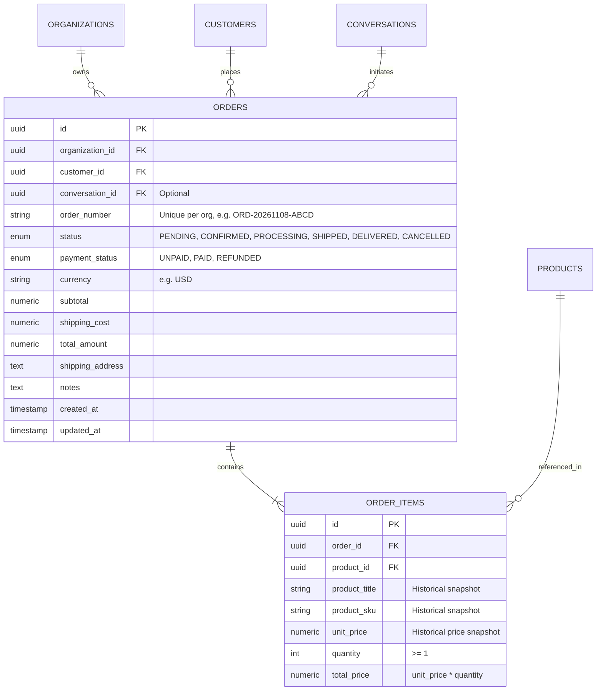
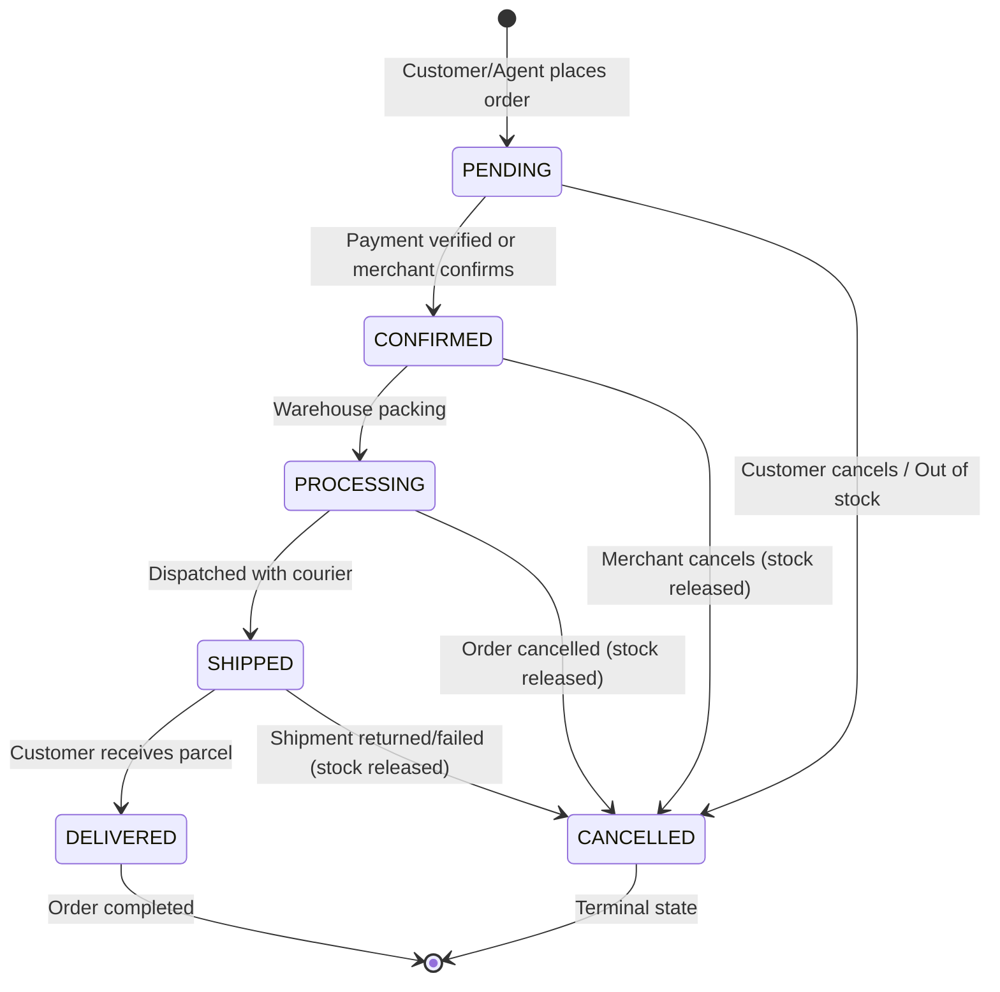

# Implementation Plan: 005-orders

## 1. Architecture & Entity Relationship

---

## 2. Order State Machine Transition Graph

---

## 3. Implementation Phases

1. **Phase 1: Domain Models & Database Central Registry**:
   - Define `Order`, `OrderItem`, `OrderStatus`, and `PaymentStatus` in `app/modules/orders/models.py`.
   - Re-export in `app/db/models.py`.
2. **Phase 2: Database Migration**:
   - Create Alembic revision `004_orders_and_order_items.py`.
   - Add unit tests verifying schema creation, foreign key constraints, and downgrade cleanup.
3. **Phase 3: Validation Schemas**:
   - Define Pydantic v2 schemas: `OrderItemCreate`, `OrderItemRead`, `OrderCreate`, `OrderUpdate`, `OrderStatusUpdate`, `OrderRead`, `OrderListResponse`.
4. **Phase 4: Business Services & State Machine**:
   - `OrderService`:
     - `create_order`: Validates tenant products, calculates financial totals, locks inventory via `with_for_update()`, generates unique order number, inserts order and line items.
     - `update_status`: Validates directed state transition graph.
     - `cancel_order`: Transitions status to `CANCELLED` and triggers `InventoryService.adjust_stock(..., change_amount=+qty, reason=ORDER_RELEASE)` to release held stock.
     - `get_order` & `list_orders`: Tenant-scoped queries with eager loaded items and customer details.
5. **Phase 5: REST API Endpoints**:
   - Router `/api/v1/orders` mounted in `app/api/router.py`.
   - Endpoints: `POST /orders`, `GET /orders`, `GET /orders/{id}`, `PATCH /orders/{id}/status`, `POST /orders/{id}/cancel`.
6. **Phase 6: Multi-Tenant Order Isolation & Concurrency Verification**:
   - Verify Tenant A cannot access, modify, or cancel Tenant B's orders.
   - Verify stock reservation and release under concurrent checkout attempts.

