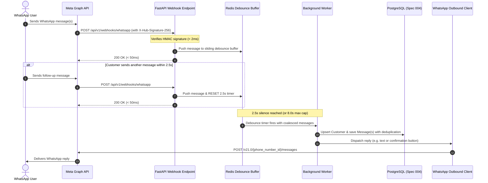

# Implementation Plan: 006-message-processing

## 1. Architectural Overview
This module bridges the external Meta WhatsApp Cloud API with Chatrio's internal database and conversation models.

---

## 2. Sliding Window Debounce Mechanics
To handle multi-message bursts cleanly:
1. **Redis Key Design**:
   - `whatsapp:debounce:{org_id}:{phone_number}:messages` (Redis List storing JSON message payloads)
   - `whatsapp:debounce:{org_id}:{phone_number}:first_received_at` (Redis String tracking start of burst for 8.0s hard cap)
   - `whatsapp:debounce:{org_id}:{phone_number}:timer` (Key with sliding TTL = 2.5s)
2. **On Each Inbound Message**:
   - Check if `first_received_at` exists; if not, set to current timestamp.
   - Calculate elapsed time since `first_received_at`.
   - If elapsed time $\ge$ 8.0s, immediately flush and process!
   - Otherwise, append message to the list and reset the sliding timer to 2.5s.
3. **Timer Expiration / Flush**:
   - When the sliding timer expires without a reset, or max cap is reached, all buffered messages are extracted and merged into a single conversational turn.

---

## 3. Implementation Phases

1. **Phase 1: Configuration & Settings**:
   - Add `redis` to `pyproject.toml`.
   - Update `app/core/config.py` with Meta settings (`meta_app_secret`, `meta_verify_token`, `meta_access_token`, `meta_phone_number_id`, `whatsapp_debounce_seconds`, `whatsapp_debounce_max_wait_seconds`).
2. **Phase 2: Security & HMAC Signature Verification**:
   - Create `app/modules/messaging/security.py` with `verify_meta_signature(raw_body, signature, app_secret)`.
   - Add unit tests verifying valid signatures, invalid signatures, and tampered bodies.
3. **Phase 3: Webhook Schemas & Handshake Endpoint**:
   - Create `app/modules/messaging/schemas.py` for Meta webhook query parameters, incoming payload structures, and outbound message models.
   - Implement `GET /api/v1/webhooks/whatsapp` in `app/modules/messaging/router.py` to handle Meta challenge verification.
4. **Phase 4: Fast Ingestion & Sliding Debounce Buffer**:
   - Create `app/modules/messaging/debounce.py` with `SlidingDebounceBuffer` (supporting Redis with in-memory fallback for local testing).
   - Implement `POST /api/v1/webhooks/whatsapp` in `router.py` executing signature verification and rapid queuing.
5. **Phase 5: Inbound Payload Parsing & Customer/Conversation Persistence**:
   - Implement `app/modules/messaging/service.py` (`MessagingService.process_incoming_payload`).
   - Extract message text, sender name, timestamp, and message ID.
   - Look up or register customer via `CustomerService`, append messages via `MessageService`.
6. **Phase 6: Outbound WhatsApp Cloud API Client**:
   - Implement `app/infrastructure/whatsapp/client.py` (`WhatsAppClient`).
   - Asynchronous methods: `send_text_message`, `send_interactive_buttons`.
   - Mocked HTTP responses for isolated unit testing.
7. **Phase 7: Comprehensive Integration Verification**:
   - Integration tests covering webhook verification, HMAC security, multi-message sliding burst coalescing, and outbound API calls.

